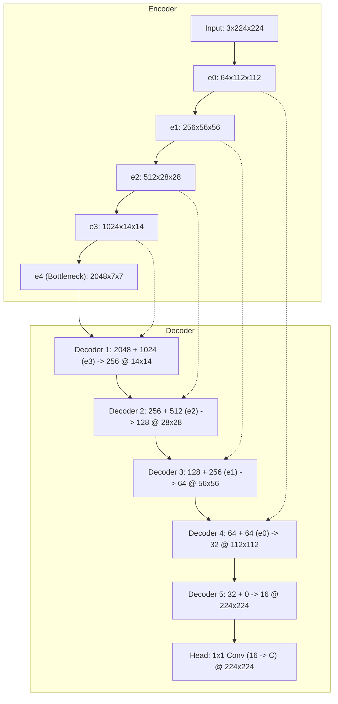

# Phase 12 Architecture Specification: ResNet-50 U-Net

## 1. Executive Summary

This document specifies the exact architecture of the **ResNet-50 U-Net** implemented for **Phase 12**. The core objective of Phase 12 is to isolate the architectural differences between Vision Transformers (Swin-Tiny) and Convolutional Neural Networks (CNNs) by eliminating the pretraining confound: both architectures are evaluated with an **ImageNet-1K pretrained backbone** fine-tuned on the breast ultrasound (BUSI) dataset and evaluated zero-shot on the external BUS-BRA dataset ($N = 1,063$).

The model is defined in [models/resnet50_unet.py](file:///D:/Study%20Material/Research/CV/vision_transformer_research/models/resnet50_unet.py).

---

## 2. Encoder: Canonical ResNet-50 Backbone

The encoder is standard torchvision ResNet-50 (He et al., 2016) initialized with official ImageNet-1K V1 weights (`ResNet50_Weights.IMAGENET1K_V1`). The network extracts a multi-scale pyramid of 5 feature representations:

| Stage | Module Name | PyTorch Sub-layers | Output Resolution ($H \times W$) | Output Channels ($C$) | Receptive Field Growth |
|---|---|---|---|---|---|
| **Input** | `x` | Raw RGB Image | $224 \times 224$ | 3 | $1 \times 1$ |
| **Stage 0 (Stem)** | `e0` | `conv1` (7x7, stride 2) + `bn1` + `relu` | $112 \times 112$ | 64 | $7 \times 7$ |
| **Stage 1** | `e1` | `maxpool` (3x3, stride 2) + `layer1` (3 Bottlenecks) | $56 \times 56$ | 256 | $35 \times 35$ |
| **Stage 2** | `e2` | `layer2` (4 Bottlenecks, first stride 2) | $28 \times 28$ | 512 | $91 \times 91$ |
| **Stage 3** | `e3` | `layer3` (6 Bottlenecks, first stride 2) | $14 \times 14$ | 1024 | $203 \times 203$ |
| **Stage 4 (Bottleneck)** | `e4` | `layer4` (3 Bottlenecks, first stride 2) | $7 \times 7$ | 2048 | $427 \times 427$ |

### Bottleneck Layer Topology
Each Bottleneck block in Stages 1–4 consists of:
$$\text{Output} = \text{ReLU}\left(\mathcal{F}(x) + \mathcal{W}_s(x)\right)$$
where $\mathcal{F}(x) = \text{Conv}_{1\times1}(C \to C_{mid}) \to \text{BN} \to \text{ReLU} \to \text{Conv}_{3\times3}(C_{mid} \to C_{mid}) \to \text{BN} \to \text{ReLU} \to \text{Conv}_{1\times1}(C_{mid} \to C_{out}) \to \text{BN}$.
The skip connection $\mathcal{W}_s(x)$ uses a $1\times 1$ projection convolution when spatial downsampling or channel dimension expansion occurs.

---

## 3. Decoder: 5-Stage Multi-Scale U-Net Decoder

The decoder mirrors the Ronneberger et al. (2015) symmetric U-Net design, adapting channel widths to interface seamlessly with the ResNet bottleneck dimensions:

### Decoder Block Mechanics
Each `DecoderBlock` executes:
1. **Upsampling**: Bilinear interpolation by factor 2 (`scale_factor=2, mode="bilinear", align_corners=True`).
2. **Feature Concatenation**: Concatenates upsampled features with the corresponding encoder skip connection tensor along channel dimension ($dim=1$).
3. **Double Convolution**:
   $$\text{Conv2d}(C_{in} + C_{skip}, C_{out}, 3\times 3, \text{pad}=1) \to \text{BatchNorm2d} \to \text{ReLU}$$
   $$\to \text{Conv2d}(C_{out}, C_{out}, 3\times 3, \text{pad}=1) \to \text{BatchNorm2d} \to \text{ReLU}$$

### Detailed Decoder Channel Schedule
| Stage | Input from Previous | Skip Connection Source | In Channels ($C_{in} + C_{skip}$) | Out Channels ($C_{out}$) | Spatial Grid |
|---|---|---|---|---|---|
| **Decoder 1** | $e4$ ($2048 \times 7 \times 7$) | $e3$ ($1024 \times 14 \times 14$) | $2048 + 1024 = 3072$ | 256 | $14 \times 14$ |
| **Decoder 2** | $d1$ ($256 \times 14 \times 14$) | $e2$ ($512 \times 28 \times 28$) | $256 + 512 = 768$ | 128 | $28 \times 28$ |
| **Decoder 3** | $d2$ ($128 \times 28 \times 28$) | $e1$ ($256 \times 56 \times 56$) | $128 + 256 = 384$ | 64 | $56 \times 56$ |
| **Decoder 4** | $d3$ ($64 \times 56 \times 56$) | $e0$ ($64 \times 112 \times 112$) | $64 + 64 = 128$ | 32 | $112 \times 112$ |
| **Decoder 5** | $d4$ ($32 \times 112 \times 112$) | None ($C_{skip} = 0$) | $32 + 0 = 32$ | 16 | $224 \times 224$ |
| **Head** | $d5$ ($16 \times 224 \times 224$) | None | 16 | $N_{classes} = 3$ | $224 \times 224$ |

---

## 4. Architectural Invariants and Controls

1. **Spatial Parity**: The input ($224 \times 224$) undergoes an exact $32\times$ downsampling to $7 \times 7$ at the bottleneck, followed by a symmetric $32\times$ upsampling back to $224 \times 224$. No spatial cropping or padding distortions occur.
2. **Receptive Field Coverage**: ResNet-50's maximum receptive field at Stage 4 reaches $427 \times 427$ pixels, substantially exceeding the image canvas ($224 \times 224$), ensuring global context is captured similarly to Swin Transformer self-attention.
3. **Multi-Scale Skip Fusion**: By retaining all 4 skip connections ($e3, e2, e1, e0$), fine boundary textures from the stem and shallow stages are preserved for sharp lesion boundary delineation.
