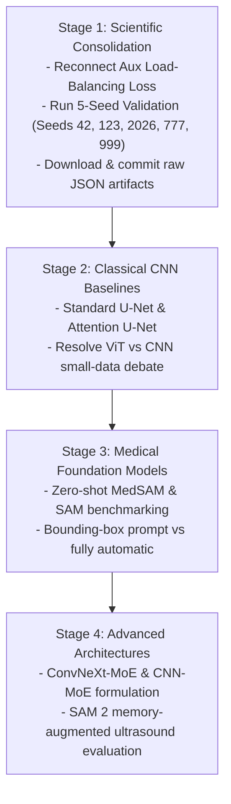

# Next Research Execution Plan: Prioritized Roadmap Beyond Phase 9

**Date**: November 12, 2026  
**Auditor & Research Architect**: Senior Computer Vision Research Engineer  
**Repository**: `D:\Study Material\Research\CV\vision_transformer_research`  

---

## 1. Prioritized Research Roadmap



---

## 2. Stage 1: Scientific Consolidation & Aux-Loss Re-Connection (Immediate Priority)

Before embarking on new architectures, Phase 9 must be brought to publication-grade rigor:

1. **Bug Fix**: In `training/train_swin_standard_moe.py`, implement an auxiliary loss collector:
   ```python
   aux_loss = sum(
       block.intermediate.moe_layer.aux_loss
       for stage in model.backbone.encoder.layers
       for block in stage.blocks
       if hasattr(block.intermediate, "moe_layer")
   )
   total_loss = criterion(logits, targets) + aux_loss
   ```
2. **5-Seed Replication**: Expand seed evaluations to $N=5$ (Seeds `[42, 123, 2026, 777, 999]`) on Kaggle GPU.
3. **Formal Statistical Testing**:
   - Conduct paired Wilcoxon signed-rank tests or two-tailed paired t-tests ($df=4$).
   - Compute effect size (Cohen's $d$).
   - Determine if $p < 0.05$ holds across foreground metrics.
4. **Artifact Download**: Ensure `reproducibility_metrics.json` and checkpoints are pulled directly into `results/phase9/`.

---

## 3. Stage 2: Classical CNN Baselines (The "ViT vs. CNN" Sanity Check)

### Research Question:
*Does Swin-MoE ($81.1\text{M}$ parameters) actually outperform a classical, properly-tuned Convolutional Neural Network ($~7\text{M} - 30\text{M}$ parameters) on a small ultrasound dataset ($N=780$)?*

Vision Transformers have weak inductive biases and often overfit on small medical datasets without massive pre-training. Benchmarking against classical CNNs is essential for publication in top medical imaging venues (MICCAI / IEEE TMI).

### Experiments to Implement:
1. **Standard U-Net** (Ronneberger et al., 2015):
   - 4-stage encoder-decoder with skip connections.
   - Parameters: $\sim 7.8\text{M}$.
2. **Attention U-Net** (Oktay et al., 2018):
   - Add spatial attention gates to skip connections to focus on tumor regions and suppress background speckle noise.
   - Parameters: $\sim 8.2\text{M}$.
3. **Modern ConvNeXt-U-Net**:
   - ConvNeXt-Tiny encoder with lightweight feature pyramid decoder.
   - Parameters: $\sim 28\text{M}$.

---

## 4. Stage 3: Medical Foundation Models (SAM & MedSAM Benchmarking)

### A. MedSAM (Medical Segment Anything Model)
- **Model Architecture**: ViT-B image encoder with bounding box prompt encoder and lightweight mask decoder, fine-tuned on 1.57 million medical image-mask pairs across 10 imaging modalities.
- **Evaluation Protocol on BUSI & BUS-BRA**:
  1. **Prompt Mode 1 (Oracle Bounding Box)**: Derive tight bounding boxes from ground truth masks perturbed by $\pm 10\text{ pixels}$ to simulate human radiologist input.
  2. **Prompt Mode 2 (Fully Automatic / Zero-Shot)**: Run automatic mask generator without human prompts.
- **Scientific Value**: Benchmarks our Swin-MoE against a $1.5\text{M}$-sample pre-trained foundation model to establish whether specialized MoE architectures can compete with massive generic foundation models.

### B. SAM 2 (Segment Anything Model 2) Feasibility
- **Architecture**: Memory-augmented streaming attention architecture designed for video and static images.
- **Application to Breast Ultrasound**:
  - While designed for video, 2D ultrasound scans can be processed through SAM 2's high-resolution memory bank.
  - Feasibility: **HIGH**. Requires $\approx 8\text{GB}$ VRAM for ViT-B/Tiny backbones, well within Kaggle's 16GB T4 / P100 limits.
- **SAM 3 Status**: SAM 3 is currently conceptual/unreleased; focus should remain on SAM and SAM 2.

---

## 5. Stage 4: Mixture-of-Experts in Convolutional Networks (CNN-MoE)

### Concept & Feasibility:
Can we integrate Mixture-of-Experts into CNNs instead of Vision Transformers?

In modern CNNs such as **ConvNeXt**, the block architecture mirrors Transformers:
- $7 \times 7$ Depthwise Convolution (Spatial mixing, analogous to Self-Attention).
- Pointwise $1 \times 1$ Convolutions / Linear projections with $4\times$ expansion (analogous to the FFN).

### Proposed Architecture: **ConvNeXt-MoE**
1. Keep the $7 \times 7$ depthwise convolution fixed.
2. Replace the pointwise $1 \times 1$ MLP block with a Mixture-of-Experts layer (`ConvNeXtMoELayer`):
   - Router operates on spatial tokens: $x \in \mathbb{R}^{H \times W \times C}$.
   - Dispatches each pixel-channel feature vector to top-2 convolutional/MLP experts.
3. **Hypothesis**: Combines the strong inductive bias of convolutions (which excels on small datasets) with the high capacity and OOD regularizing property of MoE routing.

